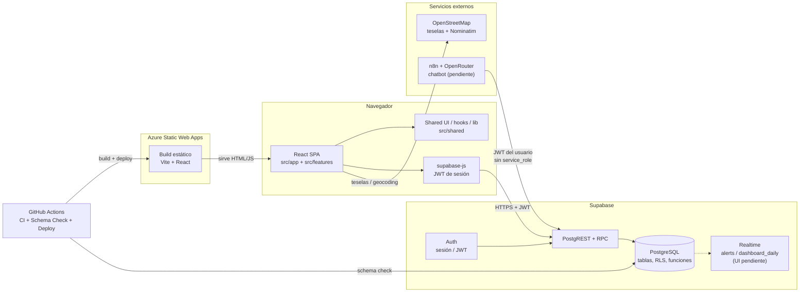
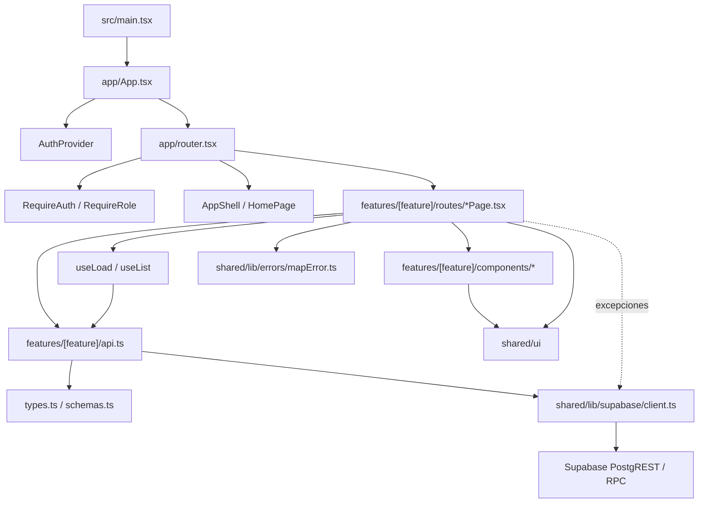
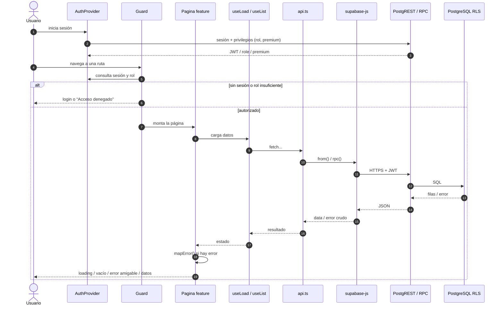
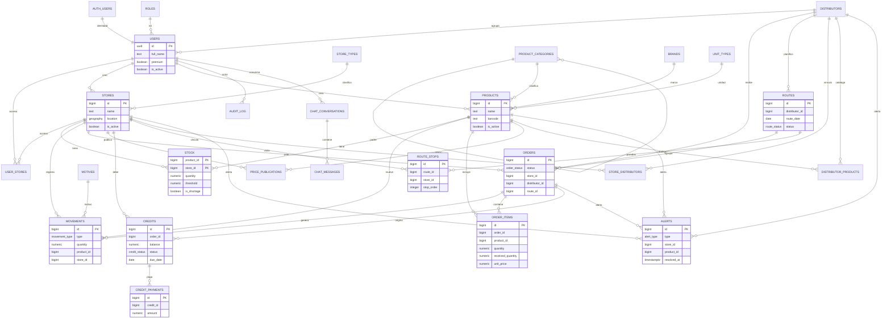
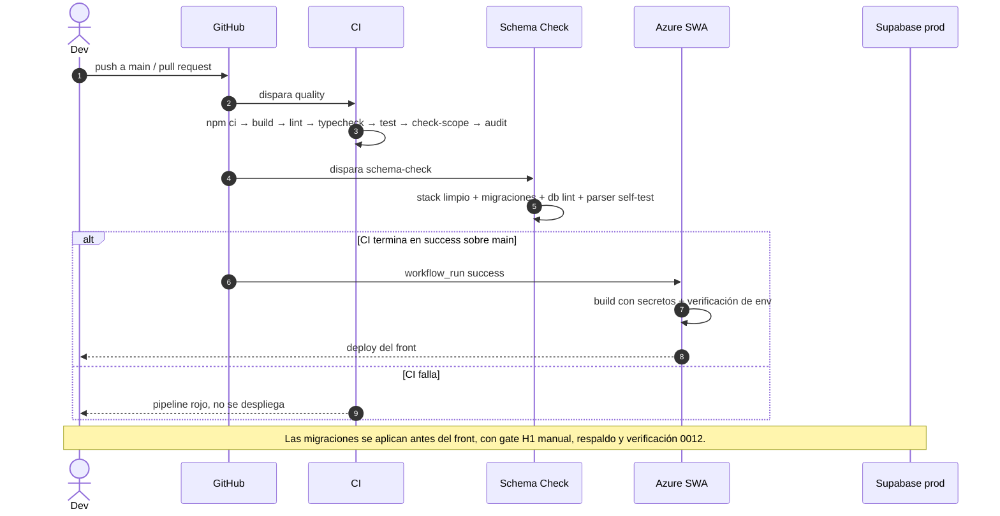
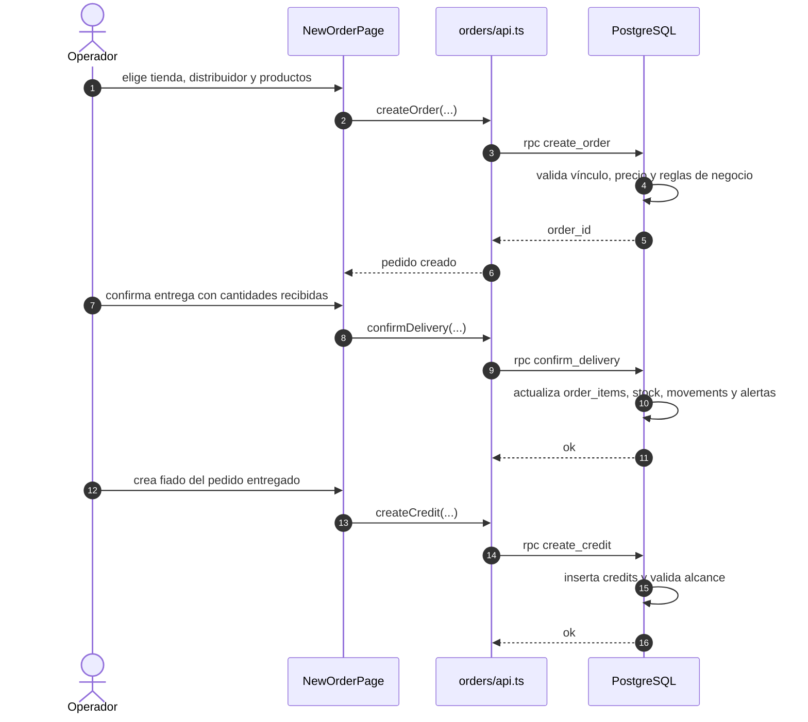
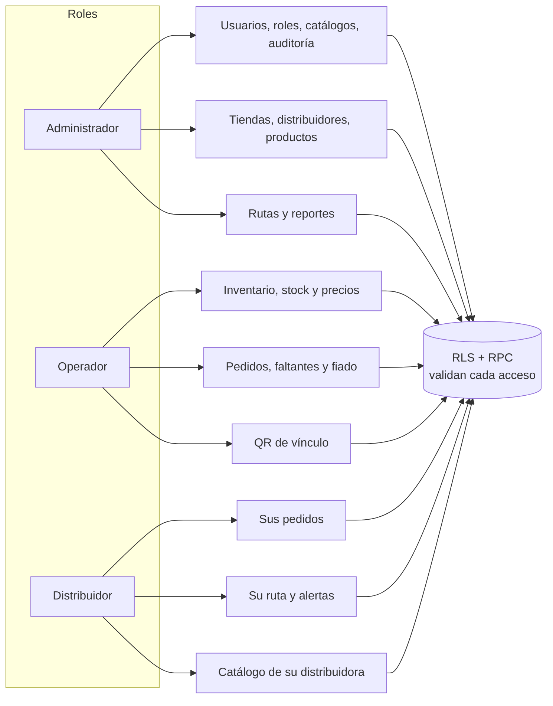

# FARØX — Informe de avance y gestión del desarrollo

> **Corte del informe:** 26 de octubre de 2026
> **Estado:** MVP funcional desplegado, con el alcance principal implementado y el cierre de calidad en curso.
> **Propósito:** documentar lo construido hasta la fecha y explicar cómo se aplicaron Design Thinking, XP y DevOps, junto con los mecanismos para absorber cambios y controlar alcance, tiempo, costo, calidad y riesgos.

---

## Ficha del documento

| Campo                      | Valor                                                                                                            |
| -------------------------- | ---------------------------------------------------------------------------------------------------------------- |
| Proyecto                   | FARØX — inventario, pedidos, rutas y fiado para tiendas y distribuidores                                         |
| Tipo                       | Informe de avance y gestión del desarrollo                                                                       |
| Versión                    | 1.1                                                                                                              |
| Fecha de corte             | 2026-10-26                                                                                                       |
| Periodo del proyecto       | 2026-09-28 → 2026-10-26                                                                                          |
| Equipo del plan            | Cristhian, Daniel e Ismenia                                                                                      |
| Aportes registrados en Git | `lyc4nthrope`, `nosee8`                                                                                          |
| Stack                      | React 19 + Vite 6 + TypeScript + Tailwind 4 + Supabase (Postgres, Auth, RLS) + Azure Static Web Apps             |
| Repositorio                | `github.com/lyc4nthrope/FAROX`                                                                                   |
| Documentos de referencia   | `docs/mvp/PLAN.md`, `docs/audits/AUDITORIA-2026-10-23.md`, `odd/tasks/*.md`, `supabase/APLICAR-EN-PRODUCCION.md` |

---

## Contenido

1. [Resumen ejecutivo](#1-resumen-ejecutivo)
2. [Contexto y problema](#2-contexto-y-problema)
3. [Design Thinking aplicado](#3-design-thinking-aplicado)
4. [XP aplicado: equipo remoto y comunicación](#4-xp-aplicado-equipo-remoto-y-comunicación)
5. [DevOps: entrega continua y manejo de errores en despliegue](#5-devops-entrega-continua-y-manejo-de-errores-en-despliegue)
6. [Capacidad de absorber cambios](#6-capacidad-de-absorber-cambios)
7. [Monitoreo y control del proyecto](#7-monitoreo-y-control-del-proyecto)
8. [Métricas y evidencia](#8-métricas-y-evidencia)
9. [Lecciones aprendidas](#9-lecciones-aprendidas)
10. [Próximos pasos](#10-próximos-pasos)
11. [Anexos](#11-anexos)

---

## 1. Resumen ejecutivo

FARØX es una aplicación web responsive para conectar tiendas y distribuidores. Resuelve un problema operativo concreto: el stock, los pedidos, las entregas, el fiado y las rutas suelen vivir en hojas de cálculo, mensajes y memoria. La aplicación concentra esos flujos en una sola base de datos, con tres roles (administrador, operador de tienda y distribuidor), reglas de negocio en PostgreSQL y un modelo Premium para funciones avanzadas.

Al corte, el proyecto tiene:

| Indicador                           |                                        Valor |
| ----------------------------------- | -------------------------------------------: |
| Commits                             |                                           88 |
| Archivos en `src/`                  |                                          243 |
| Archivos de prueba                  |                                           72 |
| Pruebas automatizadas               |                                          578 |
| Migraciones SQL                     |                                           22 |
| Documentos de feature (ODD)         |                                            6 |
| Workflows de GitHub Actions         |                                            5 |
| Ejecuciones de workflow registradas |                                          130 |
| Último pipeline remoto              | CI, Schema Check y Deploy Front en `success` |
| Despliegue                          |           Azure Static Web Apps, app `farox` |
| Base de datos                       |        Supabase / PostgreSQL, 22 migraciones |

El proceso no fue una aplicación académica y rígida de metodologías, sino una aplicación **pragmática y verificable**:

- **Design Thinking** se usó para observar necesidades reales, definir el problema, idear alternativas, prototipar rápido y evaluar con el usuario.
- **XP** se usó para trabajar en equipo remoto con comunicación frecuente, slices pequeños, pruebas primero, revisión cruzada y propiedad colectiva del código.
- **DevOps** se usó para automatizar la calidad y el despliegue, y para tratar los errores de despliegue como incidentes con causa raíz, corrección y prevención.
- El **control de cambios** se apoyó en una línea base (`main`), documentos de especificación, migraciones append-only, pruebas automatizadas y una lista explícita de recortes.

La conclusión principal es que el proyecto ya demuestra el flujo completo de negocio y tiene una base de calidad defendible. Lo que queda no es “empezar de nuevo”, sino cerrar la verificación en producción de las últimas migraciones, completar las pruebas E2E y el chatbot, y madurar la observabilidad.

### 1.1 Correspondencia con los criterios del trabajo

| Criterio solicitado                                              | Dónde se desarrolla                                                | Evidencia principal                                                                               |
| ---------------------------------------------------------------- | ------------------------------------------------------------------ | ------------------------------------------------------------------------------------------------- |
| DevOps y manejo de errores en despliegue                         | [§5](#5-devops-entrega-continua-y-manejo-de-errores-en-despliegue) | Workflows CI/Schema/Deploy, `staticwebapp.config.json`, casos de 404, OSM, seed y build sin env   |
| Design Thinking: necesidades, ideación y lluvia de ideas         | [§3](#3-design-thinking-aplicado)                                  | Necesidades observadas, tabla de alternativas/tradeoffs, prototipos y ciclos de feedback          |
| XP: comunicación remota sin pair programming                     | [§4](#4-xp-aplicado-equipo-remoto-y-comunicación)                  | Plan común, tracks, sync diaria, PR ≤ 400 líneas, revisión cruzada y documentos de feature        |
| Capacidad de absorber cambios                                    | [§6](#6-capacidad-de-absorber-cambios)                             | Auditoría F1–F24, Fase 0, rebase sobre `main`, casos QR/faltantes/fiado/Premium                   |
| Monitoreo y control de alcance, tiempo, costo, calidad y riesgos | [§7](#7-monitoreo-y-control-del-proyecto)                          | Tablero de control, presupuesto de servicios gratuitos, métricas de calidad y registro de riesgos |

La estructura interna y los siete diagramas (topología, módulos, flujo de petición, modelo de datos, CI/CD, pedido/entrega/fiado y acceso por rol) están en [§2.6](#26-arquitectura-y-conexiones-internas) y el [Anexo C](#c-diagramas-detallados).

---

## 2. Contexto y problema

### 2.1 Problema de negocio

Una tienda de barrio o un distribuidor pequeño necesita responder todos los días preguntas como:

- ¿Cuánto stock queda de cada producto y cuándo se agota?
- ¿Qué pedidos están pendientes, en ruta o entregados?
- ¿Qué productos faltan y a qué distribuidor conviene pedirlos?
- ¿Qué le debe cada tienda por fiado y cuándo vence?
- ¿Cómo se organiza la ruta de entrega?
- ¿Cómo se vincula una tienda con un distribuidor sin compartir datos sensibles?

La respuesta habitual es una combinación de cuadernos, hojas de cálculo, llamadas y mensajes. Eso produce tres problemas: información duplicada, poca trazabilidad y decisiones tardías.

### 2.2 Usuarios y roles

| Rol                | Necesidad principal                         | Qué ve en FARØX                                                                 |
| ------------------ | ------------------------------------------- | ------------------------------------------------------------------------------- |
| Administrador      | Supervisar y configurar la operación        | Usuarios, roles, catálogos, auditoría, tiendas, distribuidores, rutas, reportes |
| Operador de tienda | Operar el día a día de una o varias tiendas | Stock, alertas, pedidos, fiado, faltantes, QR de vínculo, su catálogo           |
| Distribuidor       | Recibir pedidos y cumplir la ruta           | Sus pedidos, su ruta, sus alertas, vinculación por QR, catálogo de su empresa   |

### 2.3 Alcance del MVP

El MVP incluye:

- Autenticación, confirmación de email, recuperación de contraseña, roles y RLS.
- Catálogo de productos, tiendas y distribuidores.
- Inventario por tienda: stock, umbrales, entradas, salidas, vencimientos, precios y reversos.
- Alertas de stock bajo, vencimiento, pedido atrasado y crédito vencido.
- Pedidos: creación, estados, confirmación de entrega parcial, fiado.
- Rutas: planificación, paradas, avance y enlace a mapas.
- Vínculo tienda ↔ distribuidor por QR/código.
- Dashboard analítico Premium.
- Catálogo del operador con filtros, edición de cantidad, faltantes y solicitudes.
- Funciones Premium mostradas con candado y vista previa.

Quedan fuera del corte actual, o están en cierre: chatbot con n8n, pruebas E2E con Playwright, tiempo real de alertas/dashboard y la verificación en producción de las migraciones más recientes.

### 2.4 Restricciones

- **Privacidad:** Ley 1581 de 2012 y consentimiento versionado.
- **Costo:** planes gratuitos, mapas sin API paga (Leaflet + OpenStreetMap + Nominatim) y QR generado en el cliente.
- **Seguridad:** la lógica de negocio vive en PostgreSQL; el front solo llama RPC con el JWT del usuario; `service_role` prohibido en el código y en n8n.
- **Equipo remoto:** tres frentes de trabajo que deben integrarse sin depender de reuniones presenciales.

### 2.5 Objetivos del documento

**Objetivo general:** documentar el estado de avance de FARØX y explicar cómo el equipo aplicó Design Thinking, XP y DevOps, junto con los mecanismos de absorción de cambios y control de proyecto.

**Objetivos específicos:**

- Describir las necesidades observadas y cómo se convirtieron en decisiones de producto.
- Explicar las prácticas de comunicación remota y trabajo en equipo.
- Documentar el pipeline de entrega y los errores de despliegue con su causa y prevención.
- Mostrar cómo se absorbieron cambios de usuario, auditoría, incidentes y de `main`.
- Presentar los controles de alcance, tiempo, costo, calidad y riesgos, con métricas verificables.

**Alcance del informe:** cubre el periodo 2026-09-28 → 2026-10-26 y se basa en el repositorio, los documentos del proyecto y las ejecuciones de CI. No sustituye el informe final ni la verificación en producción de cada migración.

### 2.6 Arquitectura y conexiones internas

FARØX es un **monolito modular en tres capas**: presentación (React), acceso a datos (supabase-js/PostgREST) y datos (PostgreSQL con RLS y funciones). No hay un servidor de aplicación propio: Supabase expone Auth, PostgREST y RPC; Azure Static Web Apps sirve el front estático.



| Capa             | Tecnología                                 | Responsabilidad                                             | Evidencia                                                |
| ---------------- | ------------------------------------------ | ----------------------------------------------------------- | -------------------------------------------------------- |
| Presentación     | React 19, Vite, Tailwind 4, React Router 7 | Rutas, pantallas, componentes, estados de carga/vacío/error | `src/app`, `src/features/*/routes`, `src/shared/ui`      |
| Dominio de front | TypeScript, zod, hooks                     | Tipos, validación de formularios, orquestación de pantallas | `types.ts`, `schemas.ts`, `useLoad`, `useList`           |
| Acceso a datos   | `@supabase/supabase-js`                    | Consultas, RPC y sesión; el JWT viaja en cada request       | `src/shared/lib/supabase/client.ts`, `features/*/api.ts` |
| Datos            | PostgreSQL (Supabase)                      | Tablas, RLS, funciones `SECURITY DEFINER`, triggers, jobs   | `supabase/migrations`, `supabase/entities`               |
| Identidad        | Supabase Auth                              | Registro, login, confirmación, recuperación, sesión         | `src/features/auth`, `AuthProvider`                      |
| Entrega          | GitHub Actions + Azure SWA                 | Calidad, esquema y despliegue del front                     | `.github/workflows`, `public/staticwebapp.config.json`   |

**Estructura del frontend:**

```text
src/
├── app/
│   ├── App.tsx
│   ├── router.tsx
│   ├── guards/            # RequireAuth, RequireRole, AccessDenied
│   ├── providers/         # AuthProvider (sesión, rol, premium)
│   └── shell/             # AppShell, HomePage, navigation
├── features/
│   ├── auth/
│   ├── products/
│   ├── stores/
│   ├── inventory/
│   ├── orders/
│   ├── logistics/
│   ├── distributors/
│   ├── store-links/
│   ├── users/
│   ├── roles/
│   ├── catalogs/
│   ├── audit/
│   ├── profile/
│   └── legal/
└── shared/
    ├── ui/                # Box, DataTable, Modal, PremiumLock, Pager...
    ├── hooks/             # useLoad, useList
    └── lib/               # supabase client, mapError, format, geo
```



> **Regla de dependencia:** las pantallas orquestan, los componentes presentacionales reciben props y la mayoría de las features concentran el acceso a datos en `api.ts`. Existen excepciones puntuales (por ejemplo, `DashboardPage` y `ReactivateBanner`) que importan el cliente directamente. La lógica de negocio y la seguridad viven en PostgreSQL; el front no es la última defensa. También hay dependencias puntuales entre features (por ejemplo, pedidos y faltantes reutilizan `store-links/api.ts`), documentadas en el código.

Los diagramas detallados de flujo, datos y CI/CD están en el [Anexo C](#c-diagramas-detallados).

---

## 3. Design Thinking aplicado

> **Enfoque:** no se ejecutó un taller de cinco días con post-its. Se aplicaron las cinco etapas de forma continua y documentada, adaptadas a un equipo pequeño que construye un MVP con retroalimentación directa del usuario.

### 3.1 Empatizar: observar antes de construir

La primera fuente de necesidades fue la observación del flujo real de una tienda y su distribuidor. La segunda fue la retroalimentación directa del usuario durante las iteraciones. Esa voz se convirtió en especificaciones verificables, no en una lista de deseos.

Ejemplos de necesidades observadas y su traducción:

| Necesidad observada (síntesis)                                 | Interpretación                                          | Decisión de producto                                                                                              |
| -------------------------------------------------------------- | ------------------------------------------------------- | ----------------------------------------------------------------------------------------------------------------- |
| El QR era siempre el mismo y no se entendía cómo vincular      | El vínculo no era visible ni explicable                 | Generar el código **a demanda**, mostrar el bloque cuando no hay vínculos y explicar el flujo en tres pasos       |
| Los faltantes solo los debe ver el operador de esa tienda      | El distribuidor no debe ver la intimidad del inventario | `list_shortage_products()` resuelve por `my_store_ids()` y el distribuidor solo se entera cuando recibe un pedido |
| No se puede crear un fiado                                     | El operador no podía cerrar el ciclo del crédito        | `create_credit` habilitado para el operador dueño de la tienda, desde un pedido entregado                         |
| Las acciones Premium deberían salir con candado y vista previa | Ocultar la función no comunica su valor                 | Componente `PremiumLock`: candado, beneficios, vista previa decorativa y UI real deshabilitada                    |
| Todas las vistas deben ser responsive                          | El uso principal ocurre en el celular                   | Pasada responsive: tablas con scroll, grillas que colapsan, modal a ancho completo, shell y paginador móviles     |
| La lista debe soportar cientos de productos                    | El catálogo crece y la página no debe degradarse        | Paginación server-side de 25 por página y filtros en el servidor                                                  |

La auditoría técnica del 23 de octubre también funcionó como una forma de “escuchar” al producto: midió pruebas, cobertura, mutaciones, CI y seguridad, y produjo 24 hallazgos (F1–F24) que se convirtieron en la Fase 0 del plan.

### 3.2 Definir: convertir necesidades en especificaciones

Cada bloque de trabajo se documentó en un archivo de feature con:

- Especificaciones numeradas (`S1`, `S2`, …) con criterios de aceptación.
- Tareas enlazadas a cada especificación.
- Fragmentos textuales del pedido original en el log.
- Evidencia de cierre: commits, pruebas, gate y pendientes.

Ejemplo real: el documento `odd/tasks/ajustes-qr-faltantes-fiado-premium-responsive.md` define seis especificaciones (QR a demanda, faltantes solo del operador, solicitud de faltantes, fiado del operador, Premium con candado, responsive) y siete tareas con su commit correspondiente.

Esto evita el problema clásico de “creo que el usuario quería otra cosa”: la necesidad queda escrita, la solución queda acotada y la verificación queda registrada.

### 3.3 Idear: alternativas y tradeoffs

La ideación no fue una lluvia de ideas sin filtro. Cada alternativa se contrastó con la base de datos, la seguridad y el costo.

| Problema                       | Alternativas consideradas                                                     | Decisión                                                           | Por qué                                                                                           |
| ------------------------------ | ----------------------------------------------------------------------------- | ------------------------------------------------------------------ | ------------------------------------------------------------------------------------------------- |
| Vincular tienda y distribuidor | Compartir un ID; usar un QR permanente; generar un código aleatorio a demanda | `store_distributors` + `link_code` aleatorio, QR a demanda         | Un ID adivinable permitiría vincularse a cualquier tienda; un QR permanente no se puede invalidar |
| Ver faltantes                  | Tabla nueva de faltantes; campo booleano en `stock`; cálculo derivado         | `stock.is_shortage` + RPC por alcance                              | Menos estructura, se borra con el producto y entra en el mismo listado paginado                   |
| Editar cantidad                | Generar un movimiento de ajuste siempre; actualizar `stock` sin movimiento    | Actualización directa de `stock.quantity` + reevaluación de alerta | El usuario pidió editar sin generar movimiento; el tradeoff se documentó explícitamente           |
| Eliminar producto con stock    | Bloquear; borrar en silencio; doble confirmación                              | Doble confirmación + salida con motivo `ajuste`                    | Se preserva la trazabilidad del ledger cuando se descartan existencias                            |
| Mapas                          | Google Maps API; Leaflet + OSM; mapa propio                                   | Leaflet + OSM + Nominatim                                          | Sin API key ni costo por uso; el enlace a Google Maps se usa solo para navegación                 |
| Acciones Premium               | Ocultarlas; deshabilitarlas sin explicación; candado con preview              | `PremiumLock` con candado, beneficios y preview                    | Comunica el valor sin engañar: la UI real queda deshabilitada y la DB sigue rechazando            |
| Chatbot                        | `service_role`; JWT del usuario; sin chatbot                                  | n8n con JWT + RLS, escrituras solo con confirmación                | Un prompt injection no debe poder leer todo ni crear pedidos                                      |

### 3.4 Prototipar: de “cajas simples” al sistema visual

La primera versión de las pantallas fue intencionalmente simple: cajas, formularios, estados de carga/vacío/error y textos amigables. El objetivo era validar el flujo, no la estética.

Después de validar el flujo, se hizo una segunda pasada de diseño:

- Shell con marca, rol, insignia Premium, navegación en píldoras y menú móvil.
- Home tipo panel, con hero y tarjetas de secciones.
- Dashboard Premium con KPIs, atajos de rango y barras por distribuidor.
- `PremiumLock` como teaser visual, no como botón gris.
- Sistema compartido: `Box`, tablas, `Badge`, inputs, botones, `Pager`, `Modal`, `EmptyState` y `ErrorBanner`.
- Estados vacíos con explicación y acciones sugeridas.

El prototipo no fue solo visual: `ExampleDashboard` y `PremiumLock` funcionan como “vista previa” de una función que el usuario todavía no puede usar. Eso permite validar la propuesta de valor antes de habilitarla.

### 3.5 Evaluar: ciclos cortos de retroalimentación

Cada iteración siguió un ciclo:

```text
Necesidad → especificación → prototipo/slice → prueba automatizada → demo/feedback → ajuste
```

Evidencia de ajustes reales:

- El QR pasó de generarse automáticamente a generarse a demanda, con un estado vacío explicativo.
- Los faltantes pasaron de ser visibles para el distribuidor a estar limitados al operador de la tienda.
- El fiado pasó de ser solo del admin a poder ser creado por el operador dueño de la tienda.
- Las acciones Premium pasaron de un botón deshabilitado a un candado con beneficios y vista previa.
- La vista de productos del operador incorporó filtros, edición de cantidad, baja con doble confirmación, faltantes y paginación.
- La interfaz completa se volvió responsive.

La evaluación no dependió solo de la opinión: cada cambio se cerró con pruebas y con el gate de CI. Si el cambio tocaba la base de datos, se documentó la migración y se agregó el runbook de aplicación.

### 3.6 Resultado de Design Thinking

El principal resultado no fue “una UI bonita”, sino un producto que:

- Resuelve necesidades observadas, no supuestas.
- Explica las funciones que el usuario todavía no puede usar.
- Convierte cada necesidad en una especificación verificable.
- Documenta los tradeoffs para que el equipo no los redescubra.
- Permite iterar sin romper la seguridad ni la integridad de los datos.

---

## 4. XP aplicado: equipo remoto y comunicación

> **Aclaración:** no se practicó pair programming formal. Se priorizó una comunicación remota frecuente, escrita y verificable: especificaciones compartidas, PRs revisados, sincronización diaria y decisiones registradas.

### 4.1 Equipo y división del trabajo

El plan del MVP dividió el trabajo en tres tracks autocontenidos:

| Track | Responsable | Alcance                                                            |
| ----- | ----------- | ------------------------------------------------------------------ |
| A     | Cristhian   | Chatbot, rutas y mapa, QR, vistas del distribuidor, seguridad      |
| B     | Daniel      | DevOps y base de datos, inventario, alertas, precios, fiado        |
| C     | Ismenia     | Pedidos y entregas, dashboard, pruebas E2E, manual, informe y demo |

A partir del 24 de octubre el trabajo se ejecutó de forma integrada, con una lista única de tareas. Los archivos de track quedaron como detalle técnico y como mecanismo de continuidad: si una persona no estaba disponible, otra podía retomar la tarea sin reconstruir el contexto.

### 4.2 Prácticas XP observadas

| Práctica XP         | Cómo se aplicó                                                                                                | Evidencia                                    |
| ------------------- | ------------------------------------------------------------------------------------------------------------- | -------------------------------------------- |
| Comunicación        | Sincronización diaria de 15 minutos, canal del equipo, avisos antes/después de fusionar                       | `docs/mvp/PLAN.md` §6 y reglas §0            |
| Simplicidad         | La rebanada más pequeña que entrega valor; sin TanStack Query; `useList` en lugar de una capa nueva           | Decisión D3-2, `src/shared/hooks/useList.ts` |
| Retroalimentación   | Pruebas primero, CI en cada push, revisión cruzada, auditoría externa                                         | `ci.yml`, 578 pruebas, auditoría F1–F24      |
| Valentía            | Se corrigieron errores estructurales (RLS recursiva, migración 0011, deploy) en lugar de rodearlos            | Commits `8b808b2`, Fase 0 del plan           |
| Respeto             | Definición de Terminado compartida; nadie fusiona sin revisión; el que rompe avisa                            | §5 del plan, plantilla de PR                 |
| Releases pequeños   | Commits por unidad de trabajo; PR ≤ 400 líneas; rebase antes de revisión                                      | Reglas §0 y §4.4                             |
| Propiedad colectiva | Documentos de track autocontenidos; cualquier integrante puede tomar una tarea                                | `docs/mvp/TRACK-*.md`                        |
| Ritmo sostenible    | Plan de 10 días hábiles con lista explícita de recortes                                                       | §6 del plan                                  |
| Refactorización     | Se extrajeron primitivas compartidas (`Box`, `Modal`, `PremiumLock`, `DataTable`) y se corrigió deuda técnica | Commits de UI y auditoría                    |
| Cliente presente    | Retroalimentación directa del usuario/Product Owner en cada iteración                                         | Logs `L1`–`L4` de los documentos de feature  |

### 4.3 Ritmo de comunicación

| Momento               | Qué se comunica                                      | Resultado                                       |
| --------------------- | ---------------------------------------------------- | ----------------------------------------------- |
| Diario (15 min)       | Qué se fusionó, qué está bloqueado, qué sigue        | Ajuste de prioridades y desbloqueo              |
| Por PR                | Qué cambió, cómo se verificó, checklist de alcance   | Revisión cruzada y merge seguro                 |
| Por cambio de alcance | Pedido original, interpretación, decisión y tradeoff | Se actualiza la especificación, no se improviza |
| Por incidente         | Síntoma, causa raíz, corrección, prevención          | Aprendizaje y prevención de recurrencia         |
| Por hito              | Estado del plan, riesgos, recortes                   | Control de tiempo y alcance                     |

### 4.4 Comunicación remota sin pair programming

La comunicación se apoyó en artefactos que no dependen de la simultaneidad:

- **Plan común** con estado, decisiones, calendario, calidad y riesgos.
- **Un archivo por track** con tareas, dependencias y criterios de aceptación.
- **Documentos de feature** con especificaciones, tareas y log de decisiones.
- **Pull requests** con plantilla de verificación.
- **GitHub Actions** como fuente objetiva de verdad: la regla del equipo es no fusionar con el pipeline rojo.
- **Mensajes de commit** descriptivos y enlaces a commits en las especificaciones.
- **Runbooks** para operaciones sensibles (aplicar migraciones, desplegar).

Esto reemplaza parcialmente la cercanía física: no hay una persona mirando la pantalla del otro, pero sí hay un registro escrito de qué se decidió, por qué y cómo se verificó.

### 4.5 Brechas de XP

- No hubo pair programming formal; la revisión de PR y las sesiones de demo cubren parte de ese beneficio, pero no la exploración conjunta en tiempo real.
- No hay una métrica de lead time ni de frecuencia de despliegue; el control es por hitos y commits.
- La rotación entre tracks fue limitada: la propiedad colectiva está documentada, pero en la práctica cada track tuvo un dueño principal.

---

## 5. DevOps: entrega continua y manejo de errores en despliegue

### 5.1 Pipeline de entrega

```text
push / pull request
        │
        ▼
┌─────────────────────────────────────────────┐
│ CI (quality)                                │
│ npm ci → build → lint → typecheck → test    │
│ → check-scope → npm audit --audit-level=high│
└─────────────────────────────────────────────┘
        │
        ▼
┌─────────────────────────────────────────────┐
│ Schema Check                                │
│ stack limpio + migraciones + db lint        │
│ parser con self-test “prove-by-break”       │
└─────────────────────────────────────────────┘
        │  (solo push a main, CI exitoso)
        ▼
┌─────────────────────────────────────────────┐
│ Deploy Front                                │
│ build con secretos → verificación de env    │
│ → Azure Static Web Apps (app “farox”)       │
└─────────────────────────────────────────────┘
```

| Workflow            | Disparador                              | Qué controla                                                      |
| ------------------- | --------------------------------------- | ----------------------------------------------------------------- |
| `ci.yml`            | push a `main` y PRs                     | Calidad del código, pruebas, alcance y vulnerabilidades           |
| `schema-check.yml`  | push a `main` y PRs                     | Que las migraciones se apliquen de cero en un stack limpio        |
| `deploy-front.yml`  | `workflow_run` de CI en `main` + manual | Despliegue solo si CI pasó; sin previews que apunten a producción |
| `backup-weekly.yml` | manual (schedule desactivado)           | Dump + drill de restore; pendiente de cifrado                     |
| `spike-repair.yml`  | manual                                  | Reparación de un spike técnico                                    |

Decisiones de DevOps relevantes:

- **Despliegue condicionado:** `deploy-front` se dispara con `workflow_run` y solo si CI terminó en `success` y el evento fue un push. Un PR no despliega.
- **Sin entornos de preview:** un preview de Azure apuntaría al mismo Supabase de producción. Se prefirió no exponer un entorno público adicional.
- **Concurrencia:** el grupo `deploy-front` evita despliegues simultáneos.
- **Mínimo privilegio:** `permissions: contents: read` en los workflows.
- **Fail-fast de configuración:** el deploy falla si falta `VITE_SUPABASE_URL` y verifica que la URL aparezca en `dist/assets`; no se publica un build sin backend.
- **Migraciones antes que front:** el runbook indica aplicar la base de datos antes de desplegar el front nuevo, porque el front nuevo llama RPC que la base vieja no tiene.

### 5.2 Manejo de errores en despliegue: casos reales

#### Caso 1 — Enlaces profundos devolvían 404 en Azure SWA

| Campo      | Detalle                                                                                                 |
| ---------- | ------------------------------------------------------------------------------------------------------- |
| Síntoma    | Al recargar una ruta como `/pedidos/5` o `/inventario/3`, Azure Static Web Apps devolvía 404.           |
| Causa raíz | SWA sirve archivos estáticos; no sabía reescribir rutas del SPA al `index.html`.                        |
| Corrección | `public/staticwebapp.config.json` con `navigationFallback.rewrite = /index.html` y exclusión de assets. |
| Prevención | El archivo de configuración vive en el repo y se versiona con el código; commit `9d3a2fa`.              |

#### Caso 2 — Los mapas mostraban “Access blocked” en producción

| Campo      | Detalle                                                                                                                                            |
| ---------- | -------------------------------------------------------------------------------------------------------------------------------------------------- |
| Síntoma    | Las teselas de OpenStreetMap no cargaban y aparecía la imagen de bloqueo.                                                                          |
| Causa raíz | Azure SWA aplica por defecto `Referrer-Policy: same-origin`; las peticiones a `tile.openstreetmap.org` llegaban sin `Referer` y OSM las bloqueaba. |
| Corrección | `globalHeaders.Referrer-Policy = strict-origin-when-cross-origin` en `staticwebapp.config.json`.                                                   |
| Prevención | La configuración de despliegue incluye la política de referrer; commit `fe1a7d9`.                                                                  |

#### Caso 3 — Schema Check en rojo por el seed de demo

| Campo      | Detalle                                                                                                                            |
| ---------- | ---------------------------------------------------------------------------------------------------------------------------------- |
| Síntoma    | El job `schema-check` fallaba con `relation "_seed_catalog" does not exist` al iniciar un stack limpio.                            |
| Causa raíz | La CLI de Supabase ejecuta automáticamente `supabase/seed.sql` en `db start`; el seed de demo no está pensado para un stack vacío. |
| Corrección | Se renombró a `supabase/demo-catalog.sql`, que se aplica a mano desde el SQL Editor.                                               |
| Prevención | El nombre del archivo ya no coincide con el hook automático de la CLI; commit `57486c4`.                                           |

#### Caso 4 — Build sin URL de Supabase

| Campo      | Detalle                                                                                                        |
| ---------- | -------------------------------------------------------------------------------------------------------------- |
| Síntoma    | Un build podía publicarse sin la URL de Supabase y romper en runtime.                                          |
| Causa raíz | Las variables de entorno del front son de build-time; si faltaba el secreto, Vite generaba un bundle inválido. |
| Corrección | Paso `test -n "$SUPABASE_URL"` y `grep -rqF "$SUPABASE_URL" dist/assets` en el workflow.                       |
| Prevención | El deploy falla antes de publicar; no hay “verde fantasma”.                                                    |

#### Caso 5 — Orden de migraciones y recuperación

| Campo       | Detalle                                                                                                                                                                            |
| ----------- | ---------------------------------------------------------------------------------------------------------------------------------------------------------------------------------- |
| Riesgo      | Aplicar el front nuevo antes que las migraciones rompe las RPC; aplicar migraciones sin respaldo impide volver atrás.                                                              |
| Control     | Runbook `supabase/APLICAR-EN-PRODUCCION.md`: respaldo manual, snapshot de policies, diagnóstico de solo lectura, aplicación en orden, verificación con `0012` y smoke local 45/45. |
| Responsable | Una sola persona (gate H1), en una sola ventana, con aviso al canal antes y después.                                                                                               |
| Prevención  | Migraciones idempotentes cuando es posible, migraciones append-only y verificación posterior.                                                                                      |

#### Caso 6 — RLS recursiva detectada por el smoke

| Campo      | Detalle                                                                                                       |
| ---------- | ------------------------------------------------------------------------------------------------------------- |
| Síntoma    | Inventario y rutas fallaban para usuarios no-admin por un ciclo `routes ↔ route_stops ↔ stock` (error 42P17). |
| Causa raíz | Policies que se consultaban entre sí en un ciclo.                                                             |
| Corrección | Migración 0018 con helpers `SECURITY DEFINER` para romper el ciclo.                                           |
| Prevención | Smoke de punta a punta y pruebas de contrato; commit `8b808b2`.                                               |

### 5.3 Monitoreo y observabilidad

Lo que existe:

- Estado de CI, Schema Check y Deploy Front en GitHub Actions.
- Logs de ejecución y artefactos de build.
- `npm audit` en cada pipeline.
- Verificación de esquema con `0012_verify_hardening.sql`.
- Smoke local de 45/45 flujos contra Supabase local.
- Auditoría técnica con cobertura y mutaciones.
- `mapError()` en el front: el usuario nunca ve el texto crudo del backend; los errores de negocio se traducen y se prueban.

Lo que falta:

- No hay APM ni monitoreo de errores en runtime (por ejemplo, Sentry o equivalente).
- No hay alertas automáticas de disponibilidad ni de latencia.
- No hay métricas de uso por rol ni embudo de adopción.
- El backup semanal está desactivado hasta cifrar el dump; hoy el respaldo es manual.
- No se evidencia en el repositorio un tablero formal de portafolio (Jira/Power BI); el control se apoya en GitHub, el plan y los documentos.

### 5.4 Rollback y recuperación

- **Front:** Azure SWA conserva el historial de despliegues; se puede volver a una versión anterior desde el portal o redesplegando un commit. No hay rollback automático.
- **Base de datos:** respaldo manual antes de migraciones; snapshot de policies para 0018; migraciones con bloque `-- INVERSE:` comentado cuando aplica; verificación posterior.
- **Configuración:** `staticwebapp.config.json` y los workflows están versionados; un cambio de configuración se revisa como código.
- **Secretos:** viven en GitHub Secrets/Environments, no en el repo.

---

## 6. Capacidad de absorber cambios

### 6.1 Fuentes de cambio

| Fuente                              | Ejemplo                                                                           | Cómo entra                                               |
| ----------------------------------- | --------------------------------------------------------------------------------- | -------------------------------------------------------- |
| Usuario/Product Owner               | QR a demanda, faltantes solo del operador, fiado, Premium con candado, responsive | Documento de feature con especificaciones y log          |
| Auditoría técnica                   | F1–F24: migración 0011, RLS, backup, paginación, roles, ubicación                 | Fase 0 del plan, priorizada antes de nueva funcionalidad |
| Incidente de despliegue             | 404 del SPA, teselas OSM, seed automático                                         | Commit de corrección + runbook/config                    |
| Cambio de otro integrante en `main` | Aviso de productos sin precio, empty state de movimientos, título del home        | Rebase, conflicto resuelto priorizando `main`, pruebas   |
| Descubrimiento técnico              | RLS recursiva, `count` de PostgREST, filtros que no recortaban                    | Corrección de diseño + prueba de contrato                |
| Restricción de costo                | Google Maps → Leaflet/OSM                                                         | Decisión D3-4 y actualización del plan                   |

### 6.2 Proceso de control de cambios

```text
1. Registrar la solicitud o el hallazgo
2. Analizar impacto: alcance, base de datos, seguridad, UI, pruebas, tiempo
3. Decidir y documentar el tradeoff
4. Implementar en un slice pequeño
5. Verificar con pruebas y gate
6. Comunicar, fusionar y actualizar el plan
```

El cambio no se considera “absorbido” hasta que tiene:

- Especificación o justificación escrita.
- Impacto identificado.
- Prueba o verificación.
- Registro en el documento de feature, plan o runbook.
- Comunicación al equipo.

### 6.3 Casos de absorción de cambios

| Cambio                                  | Acción                                                            | Verificación                                             |
| --------------------------------------- | ----------------------------------------------------------------- | -------------------------------------------------------- |
| Auditoría del 23/10 con 24 hallazgos    | Se creó la Fase 0; ningún feature nuevo hasta cerrar bloqueantes  | CI, Schema Check y pruebas en verde; plan v3.1           |
| Migración 0011 con error de sintaxis    | Se corrigió en el mismo archivo porque nunca se había aplicado    | Schema Check dejó de fallar; auditoría F1                |
| RLS recursiva 42P17                     | Migración 0018 con helpers `SECURITY DEFINER`                     | Smoke 45/45; rutas e inventario para no-admin            |
| QR siempre igual                        | Generación a demanda + estado vacío explicativo                   | `DistributorsPage.test.tsx`, commit `025705c`            |
| Faltantes visibles para el distribuidor | RPC por `my_store_ids()` + nav solo admin/operador                | 0023, tests de alcance, commit `63bb8cb`                 |
| Fiado solo del admin                    | `create_credit` para operador dueño de la tienda                  | `OrderDetailPage.test.tsx`, commit `c88208b`             |
| Premium como botón gris                 | `PremiumLock` con candado, beneficios y preview                   | `PremiumLock.test.tsx`, commit `225b338`                 |
| Cambios de `main` durante la entrega    | Rebase con `--autostash`; conflictos resueltos priorizando `main` | 578 pruebas, build y pipeline en verde; commit `2b575b3` |
| Productos sin precio en pedidos         | Se conservó el aviso de `main` dentro del formulario rediseñado   | `NewOrderPage.test.tsx`, commit `bbd7547`                |
| Inventario sin movimientos              | Se conservó el `EmptyState` de `main` dentro del rediseño         | `InventoryPage.test.tsx`, commit `9460f93`               |

### 6.4 Por qué el proyecto puede absorber cambios

1. **Línea base clara:** `main` es la verdad; los cambios se integran con rebase y se verifican.
2. **Especificaciones modulares:** cada feature tiene su documento y sus criterios.
3. **Pruebas como red de seguridad:** 578 pruebas permiten refactorizar y rediseñar sin miedo.
4. **Migraciones append-only:** un cambio de esquema no reescribe la historia; se agrega una migración nueva.
5. **Decisiones registradas:** los tradeoffs no se reabren por olvido.
6. **Lista de recortes:** si el tiempo aprieta, se recorta en un orden acordado, no por pánico.
7. **Documentación operativa:** el runbook de migraciones y el workflow de deploy reducen el riesgo de improvisar.

### 6.5 Límites

- Las migraciones 0020–0023 no se ejecutaron contra una base real en local; su comportamiento se valida al aplicarlas en producción.
- El backup semanal está desactivado hasta cifrar el dump.
- No hay E2E todavía; la verificación de flujos completos depende de pruebas de componentes y smoke.
- La cobertura actual no se midió después del último lote de cambios; la última medición formal es la auditoría del 23/10.

---

## 7. Monitoreo y control del proyecto

### 7.1 Alcance

| Control           | Mecanismo                                               | Evidencia                                               |
| ----------------- | ------------------------------------------------------- | ------------------------------------------------------- |
| Línea base        | Plan del MVP con alcance, tracks y criterios            | `docs/mvp/PLAN.md`                                      |
| Especificaciones  | Documentos de feature con `S#` y tareas                 | `odd/tasks/*.md`                                        |
| Límite de alcance | `check-scope.mjs`: lo no habilitado no se usa en `src/` | `npm run check-scope` → 0 coincidencias en 242 archivos |
| Tamaño de cambio  | PR ≤ 400 líneas; commits por unidad                     | Reglas del plan                                         |
| Recortes          | Orden explícito si el tiempo aprieta                    | Plan §6                                                 |
| Cambios           | Registro en log y actualización de la especificación    | Documentos de feature                                   |

**Estado:** el alcance funcional principal está implementado. Quedan chatbot, E2E y cierre documental; no hay evidencia de “scope creep” sin control, porque cada cambio tiene spec y verificación.

### 7.2 Tiempo

| Hito                    | Fecha      |
| ----------------------- | ---------- |
| Primer commit           | 2026-09-28 |
| Auditoría técnica       | 2026-10-23 |
| Plan v3.1 con Fase 0    | 2026-10-23 |
| Estado integrado        | 2026-10-24 |
| Corte de este informe   | 2026-10-26 |
| Congelamiento de código | 2026-11-04 |
| Demo final              | 2026-11-06 |

Controles:

- Sincronización diaria de 15 minutos.
- Ruta crítica explícita en el plan.
- Lista de recortes si hay atraso.
- Hitos verificables: migraciones aplicadas, smoke, CI, demo.
- Separación entre “terminado” y “pendiente de verificación en producción”.

**Estado:** el plan mantiene la fecha de congelamiento y la demo. El riesgo principal de tiempo es el cierre de chatbot/E2E y la verificación de migraciones, no el flujo principal.

### 7.3 Costo

| Concepto           | Decisión                                  | Impacto                                             |
| ------------------ | ----------------------------------------- | --------------------------------------------------- |
| Hosting del front  | Azure Static Web Apps (plan gratuito)     | Costo marginal cercano a cero                       |
| Base de datos/Auth | Supabase (plan gratuito)                  | Sin servidor propio; límites de plan                |
| Mapas              | Leaflet + OpenStreetMap + Nominatim       | Sin API key ni costo por uso                        |
| QR                 | Generación en el cliente con `qrcode`     | Sin egress de servidor                              |
| CI/CD              | GitHub Actions                            | Incluido para el repositorio público                |
| Chatbot            | n8n en VPS + OpenRouter (LLM) (pendiente) | Únicos costos potenciales: infraestructura y tokens |
| Licencias          | Stack open source                         | Sin licencias pagas                                 |

Controles:

- Evitar APIs pagas (Google Maps) y servicios gestionados innecesarios.
- Aprovechar planes gratuitos y monitorear sus límites.
- Diferir el chatbot hasta validar su valor y su costo operativo.
- No se registra un presupuesto monetario formal; el control es por decisiones de arquitectura y servicios usados.

**Estado:** no hay desvío de costo registrado; el riesgo es que el VPS de n8n y los tokens del chatbot agreguen un costo recurrente, y que los límites gratuitos se alcancen con datos reales.

### 7.4 Calidad

| Control                   | Herramienta                     | Resultado al corte                               |
| ------------------------- | ------------------------------- | ------------------------------------------------ |
| Build                     | `npm run build`                 | OK                                               |
| Lint                      | `npm run lint`                  | 0 errores                                        |
| Tipos                     | `npm run typecheck`             | 0 errores                                        |
| Pruebas                   | `vitest run`                    | 578 pruebas, 72 archivos, 0 fallos               |
| Alcance                   | `check-scope`                   | 0 coincidencias en 242 archivos                  |
| Seguridad de dependencias | `npm audit --audit-level=high`  | Sin vulnerabilidades altas en el último pipeline |
| Esquema                   | `schema-check`                  | Stack limpio + migraciones + `db lint`           |
| Contratos SQL             | Pruebas de contrato y smoke     | 45/45 flujos (2026-10-24)                        |
| Cobertura                 | Auditoría 2026-10-23            | 81,7 % líneas, 68,8 % ramas, 83,7 % funciones    |
| Mutaciones                | Auditoría 2026-10-23            | 6 de 8 detectadas                                |
| Revisión                  | PR revisado por otro integrante | Regla del plan                                   |
| Errores de usuario        | `mapError()`                    | Nunca se muestra el texto crudo del backend      |

**Estado:** verde en el corte local y remoto. La cobertura y las mutaciones son de la auditoría, no del último commit; se deben volver a medir al cierre.

### 7.5 Riesgos

| Riesgo                                            | Probabilidad        | Impacto    | Mitigación                                                                 | Estado                    |
| ------------------------------------------------- | ------------------- | ---------- | -------------------------------------------------------------------------- | ------------------------- |
| Migraciones recientes sin verificar en producción | Media               | Alto       | Gate H1, respaldo, diagnóstico, smoke, orden DB→front                      | Abierto                   |
| Backup sin cifrar en repo público                 | Media               | Alto       | Schedule desactivado; dump manual fuera del repo; cifrado pendiente (B0.4) | Abierto                   |
| Divergencia con `main` por trabajo paralelo       | Alta                | Medio      | Rebase, PR pequeños, pruebas, priorizar `main`                             | Controlado                |
| Límites de planes gratuitos                       | Media               | Medio      | Monitoreo de uso; decisiones de arquitectura; plan de escalado             | Abierto                   |
| Cámara/QR no funciona en todos los dispositivos   | Media               | Medio      | HTTPS, fallback manual, pruebas en Android/iOS                             | Mitigado parcialmente     |
| Prompt injection en chatbot                       | Alta (si se expone) | Alto       | JWT + RLS, sin `service_role`, escrituras con confirmación                 | Diseñado, pendiente       |
| Sin E2E de flujos completos                       | Media               | Medio      | Playwright H1–H4 planificado                                               | Abierto                   |
| Cobertura de API incompleta                       | Media               | Medio      | Pruebas de contrato y mutaciones; auditoría F14                            | Mejorando                 |
| Sin monitoreo runtime/APM                         | Media               | Medio      | Logs de CI, smoke y auditoría; APM pendiente                               | Abierto                   |
| Bundle inicial grande (~1,35 MB)                  | Alta                | Bajo/Medio | Code splitting y lazy loading pendientes                                   | Abierto                   |
| Dependencia de Supabase                           | Media               | Bajo       | SQL estándar; lógica portable; front desacoplado                           | Aceptado                  |
| Privacidad y consentimiento                       | Media               | Alto       | RLS, consentimiento versionado, política de privacidad                     | Controlado, revisar legal |

### 7.6 Tablero de control

| Dimensión | Indicador                                      | Meta                    | Frecuencia | Estado al corte                            |
| --------- | ---------------------------------------------- | ----------------------- | ---------- | ------------------------------------------ |
| Alcance   | Tareas del plan completadas / cambios sin spec | 100 % del alcance MVP   | Diaria     | Principal completo; chatbot/E2E pendientes |
| Tiempo    | Días hasta congelamiento / hitos               | 2026-11-04              | Diaria     | En fecha                                   |
| Costo     | Servicios pagos / costo mensual                | 0 hasta validar chatbot | Mensual    | Sin desvíos registrados                    |
| Calidad   | CI + Schema + Deploy en verde                  | 100 % en `main`         | Cada push  | Verde para `2b575b3`                       |
| Calidad   | Pruebas                                        | ≥ 500                   | Cada push  | 578                                        |
| Calidad   | Cobertura                                      | ≥ 80 % líneas           | Por hito   | 81,7 % (auditoría)                         |
| Riesgo    | Riesgos altos abiertos                         | 0 al congelamiento      | Semanal    | 2–3 abiertos                               |
| Cambio    | Cambios absorbidos con spec + prueba           | 100 %                   | Por cambio | Evidencia en docs y commits                |

---

## 8. Métricas y evidencia

### 8.1 Métricas del corte

| Métrica                 |         Valor | Fuente                    | Fecha      |
| ----------------------- | ------------: | ------------------------- | ---------- |
| Commits                 |            88 | `git log`                 | 2026-10-26 |
| Autores en Git          | 2 identidades | `git log`                 | 2026-10-26 |
| Archivos en `src/`      |           243 | Sistema de archivos       | 2026-10-26 |
| Archivos de prueba      |            72 | `src/**/*.test.*`         | 2026-10-26 |
| Pruebas                 |           578 | `npm test`                | 2026-10-26 |
| Migraciones             |            22 | `supabase/migrations`     | 2026-10-26 |
| Documentos de feature   |             6 | `odd/tasks`               | 2026-10-26 |
| Workflows               |             5 | `.github/workflows`       | 2026-10-26 |
| Ejecuciones de workflow |           130 | GitHub Actions API        | 2026-10-26 |
| Último CI               |     `success` | GitHub Actions            | 2026-10-26 |
| Último Schema Check     |     `success` | GitHub Actions            | 2026-10-26 |
| Último Deploy Front     |     `success` | GitHub Actions            | 2026-10-26 |
| Smoke local             |         45/45 | `scripts/smoke-local.mjs` | 2026-10-24 |
| Cobertura de líneas     |        81,7 % | Auditoría                 | 2026-10-23 |
| Cobertura de ramas      |        68,8 % | Auditoría                 | 2026-10-23 |
| Mutaciones detectadas   |           6/8 | Auditoría                 | 2026-10-23 |
| Hallazgos de auditoría  |   24 (F1–F24) | Auditoría                 | 2026-10-23 |

### 8.2 Evidencia principal

- **Plan y proceso:** `docs/mvp/PLAN.md`, `docs/mvp/TRACK-*.md`.
- **Auditoría:** `docs/audits/AUDITORIA-2026-10-23.md`.
- **Especificaciones y decisiones:** `odd/tasks/*.md`.
- **Base de datos:** `supabase/migrations/`, `supabase/APLICAR-EN-PRODUCCION.md`.
- **CI/CD:** `.github/workflows/ci.yml`, `schema-check.yml`, `deploy-front.yml`, `backup-weekly.yml`.
- **Configuración de despliegue:** `public/staticwebapp.config.json`.
- **Código y pruebas:** `src/feature/*`, `src/shared/*`, `src/test/*`.
- **Manual de uso:** `docs/manual/USO-POR-ROL.md`.

### 8.3 Limitaciones de las métricas

- La cobertura y las mutaciones corresponden a la auditoría del 23/10; el código cambió después.
- El smoke 45/45 corresponde a las migraciones vigentes al 24/10; las 0020–0023 no se ejecutaron contra una base real en local.
- El número de commits no mide esfuerzo ni valor; se usa solo como trazabilidad.
- “CI en verde” se refiere al último pipeline del corte; no garantiza que todos los flujos de negocio estén verificados en producción.

---

## 9. Lecciones aprendidas

1. **La base de datos es el contrato.** Poner las reglas de negocio en PostgreSQL y RLS evitó que el front fuera la única defensa; también hizo que los errores se detectaran con pruebas de contrato y smoke.
2. **La auditoría llegó a tiempo.** Los 24 hallazgos se convirtieron en una Fase 0 y se corrigieron antes de seguir agregando funciones. Sin esa pausa, los bloqueantes se habrían multiplicado.
3. **Los errores de despliegue son una fuente de diseño.** El 404 del SPA, las teselas bloqueadas y el seed automático no fueron “fallos de suerte”: cada uno dejó una configuración versionada y una prevención.
4. **El usuario cambia de opinión; el proceso debe absorberlo.** El QR, los faltantes, el fiado y Premium cambiaron después de la primera versión. Lo que funcionó fue escribir la especificación, registrar el tradeoff y verificarlo.
5. **Las pruebas son la red que permite rediseñar.** El rediseño visual y la integración con `main` se hicieron sin miedo porque había 578 pruebas y un gate de CI.
6. **La comunicación remota necesita artefactos.** Sin pair programming, los documentos de feature, los PRs y el plan diario fueron el mecanismo para que el equipo no dependiera de la memoria.
7. **`main` manda.** Durante el cierre, `main` recibió cambios de otros integrantes. Rebasear y priorizar esos cambios evitó perder funcionalidad y mantuvo la línea base.
8. **Lo que no se mide, no se controla.** El proyecto tiene buena trazabilidad de calidad y alcance, pero le faltan métricas de runtime, lead time y costo real. Es la deuda de gestión más importante.

---

## 10. Próximos pasos

| Prioridad | Acción                                                                                    | Responsable sugerido | Criterio de cierre                                             |
| --------- | ----------------------------------------------------------------------------------------- | -------------------- | -------------------------------------------------------------- |
| 1         | Verificar y aplicar las migraciones pendientes en producción (0020–0023 y las que falten) | Daniel / gate H1     | Diagnóstico, respaldo, aplicación, verificación `0012` y smoke |
| 2         | Cifrar el backup y reactivar el schedule                                                  | Daniel               | Dump cifrado, secrets por step, drill de restore               |
| 3         | Completar pruebas E2E H1–H4 con Playwright                                                | Ismenia              | Flujos de registro, stock, logística y asistente en verde      |
| 4         | Implementar/cerrar el chatbot n8n con JWT + RLS + confirmación                            | Cristhian            | Webhook 401 sin sesión, tools con RLS, propuesta + confirmar   |
| 5         | Evaluar tiempo real para alertas/dashboard                                                | Equipo               | Decisión documentada; si no, refresco manual aceptado          |
| 6         | Medir cobertura actual y agregar pruebas de API faltantes                                 | Equipo               | Cobertura ≥ 80 % en líneas y brechas F14 cerradas              |
| 7         | Reducir el bundle inicial (code splitting)                                                | Equipo               | Bundle principal por debajo del umbral acordado                |
| 8         | Completar manual de uso, informe final y ensayo de demo                                   | Ismenia / equipo     | Documento final y demo ensayada                                |
| 9         | Agregar monitoreo runtime (APM o equivalente)                                             | Equipo               | Errores de producción visibles y alertas configuradas          |

---

## 11. Anexos

### A. Glosario

| Término      | Significado                                                                |
| ------------ | -------------------------------------------------------------------------- |
| RLS          | Row Level Security de PostgreSQL: cada fila se filtra según el usuario     |
| RPC          | Función SQL expuesta por Supabase/PostgREST                                |
| Smoke        | Prueba rápida de flujos críticos contra una base real o local              |
| Schema Check | Workflow que aplica las migraciones en un stack limpio y valida el esquema |
| Gate H1      | Puerta humana para aplicar migraciones en producción                       |
| Slice        | Unidad pequeña de trabajo que entrega valor y se puede verificar           |
| ODD          | Documento de feature con especificaciones, tareas y log                    |
| Premium      | Flag de usuario que habilita funciones avanzadas                           |
| SPA          | Single Page Application                                                    |
| SWA          | Azure Static Web Apps                                                      |

### B. Mapa de evidencia

| Tema                         | Archivo / artefacto                                                     |
| ---------------------------- | ----------------------------------------------------------------------- |
| Plan, calendario y riesgos   | `docs/mvp/PLAN.md`                                                      |
| Auditoría y hallazgos        | `docs/audits/AUDITORIA-2026-10-23.md`                                   |
| Especificaciones por feature | `odd/tasks/*.md`                                                        |
| Migraciones y runbook        | `supabase/migrations/`, `supabase/APLICAR-EN-PRODUCCION.md`             |
| CI y calidad                 | `.github/workflows/ci.yml`, `schema-check.yml`                          |
| Despliegue                   | `.github/workflows/deploy-front.yml`, `public/staticwebapp.config.json` |
| Backup                       | `.github/workflows/backup-weekly.yml`                                   |
| Manual de uso                | `docs/manual/USO-POR-ROL.md`                                            |
| Código y pruebas             | `src/`                                                                  |

### C. Diagramas detallados

#### C.1 Flujo de una petición y autenticación



#### C.2 Modelo de datos principal



> **Lectura del diagrama:** `AUTH_USERS` representa `auth.users` (identidad gestionada por Supabase Auth); `AUDIT_LOG.created_by` es una referencia lógica sin FK para no perder el historial si se borra un usuario. Las tablas de catálogo (`ROLES`, `STORE_TYPES`, `PRODUCT_CATEGORIES`, `BRANDS`, `UNIT_TYPES`, `MOTIVES`) alimentan las tablas de operación. `STOCK` es la intersección producto–tienda; `MOVEMENTS` es el ledger append-only; `ORDERS` y `ORDER_ITEMS` son la cadena de pedido; `CREDITS` y `CREDIT_PAYMENTS` son el fiado; `ROUTES` y `ROUTE_STOPS` son la logística. `dashboard_daily` es una tabla derivada para el dashboard, no una fuente de verdad.

#### C.3 CI/CD y despliegue



#### C.4 Flujo de pedido, entrega y fiado



#### C.5 Acceso por rol



> Las rutas del front esconden lo que el rol no usa, pero la autorización real está en PostgreSQL: RLS filtra filas y las RPC `SECURITY DEFINER` validan alcance, rol y Premium. La UI es una ayuda, no la frontera de seguridad.

### D. Historial del documento

| Versión | Fecha      | Cambio                                                                                         |
| ------- | ---------- | ---------------------------------------------------------------------------------------------- |
| 1.0     | 2026-10-26 | Primer informe de avance con corte en `2b575b3`                                                |
| 1.1     | 2026-10-26 | Añadidos diagramas de arquitectura, flujo de petición, modelo de datos, CI/CD y acceso por rol |
